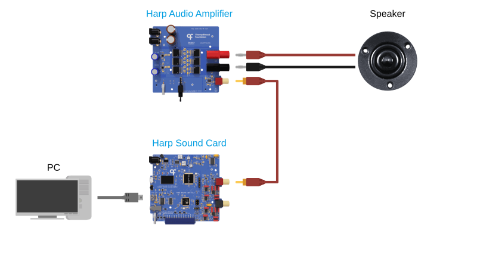

# Harp Sound Card

The Harp Sound Card is a high-fidelity audio device for behavioral neuroscience experiments. It plays stereo waveforms stored in its onboard memory, at 24-bit resolution and a sampling rate of up to 192 kHz, and pure tones from an internal sine wave generator. It starts sounds with low latency, from software or from TTL signals on its digital inputs, and timestamps each one on its hardware clock. It pairs with the Harp Audio Amplifier to drive speakers.

## Documentation

The [device documentation](https://harp-tech.org/device.soundcard) covers the specifications, setting up the device, installing the software, examples for each feature, and the register reference.

## Software

The device can be used from [Bonsai](https://bonsai-rx.org/) through the `Harp.SoundCard` package, or from Python through the `harp-soundcard` package. The Sound Card app is a desktop app for generating waveforms and uploading them to the device without using Bonsai. The [installation](https://harp-tech.org/device.soundcard/articles/installation.html) page describes how to install each of them, along with the driver needed to upload sounds.

## Repository layout

- `device.yml` describes the registers of the device. The firmware headers and the .NET and Python interfaces are generated from it.
- `firmware` holds the firmware of the device, for both of its microcontrollers.
- `hardware` holds the PCB and mechanical design files.
- `software` holds the .NET packages, including the Bonsai package and the app, and the Python package.
- `docs` holds the documentation site.

## Licensing

Each part of this repository is released under its own license. The `LICENSE` file at the root of the repository lists the licenses that apply to each folder.
