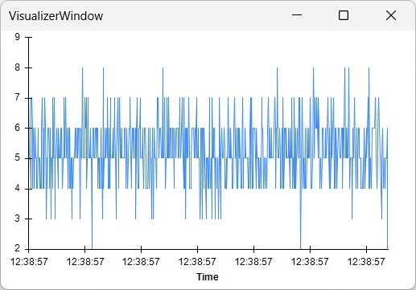

# Acquire analog data

The Sound Card can sample the voltage on its analog inputs at 1 kHz and stream each sample to Bonsai together with the current sound parameters. Refer to the [connections](./ports-connections.md?tabs=analoginputs#connections) article to set up an analog signal on **ADC0**, which we will use for the rest of these examples.

This article covers how to enable the analog data stream and visualize the analog data in Bonsai.

The complete workflow is shown below. Copy and paste it into Bonsai to get started immediately, or build each section by following the step-by-step instructions in the following sections.

:::workflow

:::

## Enable analog data stream

The analog data stream is off by default, enable it by configuring [`EnableAdcControlState`].

:::workflow

:::

- Insert a [`KeyDown`] operator and set the `Filter` property to `A`.
- Insert a [`CreateMessage`] operator and configure the following properties:
    - `Payload` - Select `EnableAdcControlStatePayload`.
    - `EnableAdcControlState` - Select `SampleRate1000Hz` to enable the analog data stream. To disable it in the future, select `Disabled`.
- Insert a [`MulticastSubject`] operator named `SoundCard Commands`.

Run the workflow and press <kbd>A</kbd>. The device starts reporting [`AdcControlState`] events, which we will cover in the next section.

## Visualize analog data

Each [`AdcControlState`] event carries five values:

| Field | Description |
| --- | --- |
| `Adc0` | The sampled value on **ADC0**. |
| `Adc1` | The sampled value on **ADC1**. |
| `AttenuationLeft` | The last left channel attenuation that was set |
| `AttenuationRight` | The last right channel attenuation that was set |
| `Frequency` | The last sound index or frequency played |

The workflow below will show you how to decode and visualize the events, and plot one channel:

:::workflow

:::

- Insert a [`SubscribeSubject`] operator named `SoundCard Events`.
- Insert a [`Parse`] operator and set the `Register` property to `TimestampedAdcControlState`.
- Insert a [`VisualizerWindow`] operator.

To plot only one of the input channels:

- Insert a [`MemberSelector`] operator on a separate branch from the [`Parse`] operator and set the `Selector` property to `Value.Adc0`. This selects the data from the first analog input channel.
- Insert a [`VisualizerWindow`] operator and set the `VisualizerType` property to `TimeSeriesVisualizer`.

Run the workflow and press <kbd>A</kbd> to enable the stream. The first visualizer displays the whole payload followed by the timestamp in seconds:

```text
AdcControlStatePayload { Adc0 = 6, Adc1 = 7, AttenuationLeft = 0, AttenuationRight = 0, Frequency = 2 }@6.973344
AdcControlStatePayload { Adc0 = 6, Adc1 = 7, AttenuationLeft = 0, AttenuationRight = 0, Frequency = 2 }@6.974344
```

The second visualizer plots the `Adc0` value over time as a 12-bit value:

{width=300}

Vary the output voltage of the other device to see the plot change.

> [!NOTE]
> The attenuation and frequency fields report the last commands sent from Bonsai. Sounds triggered from the digital inputs will overwrite the attenuation levels, but will not update these fields.

[!INCLUDE [](../includes/version-footer.md)]

<!--Reference Style Links -->
[`AdcControlState`]: xref:Harp.SoundCard.AdcControlState
[`CreateMessage`]: xref:Harp.SoundCard.CreateMessage
[`EnableAdcControlState`]: xref:Harp.SoundCard.EnableAdcControlState
[`KeyDown`]: xref:Bonsai.Windows.Input.KeyDown
[`MemberSelector`]: xref:Bonsai.Expressions.MemberSelectorBuilder
[`MulticastSubject`]: xref:Bonsai.Expressions.MulticastSubject
[`Parse`]: xref:Harp.SoundCard.Parse
[`SubscribeSubject`]: xref:Bonsai.Expressions.SubscribeSubject
[`VisualizerWindow`]: xref:Bonsai.Design.VisualizerWindow
