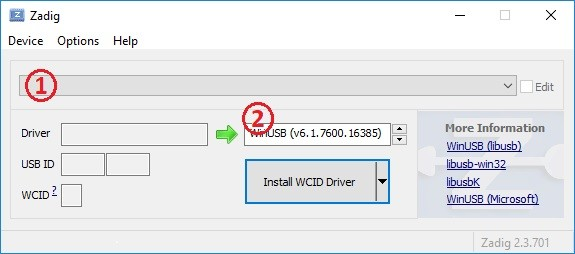
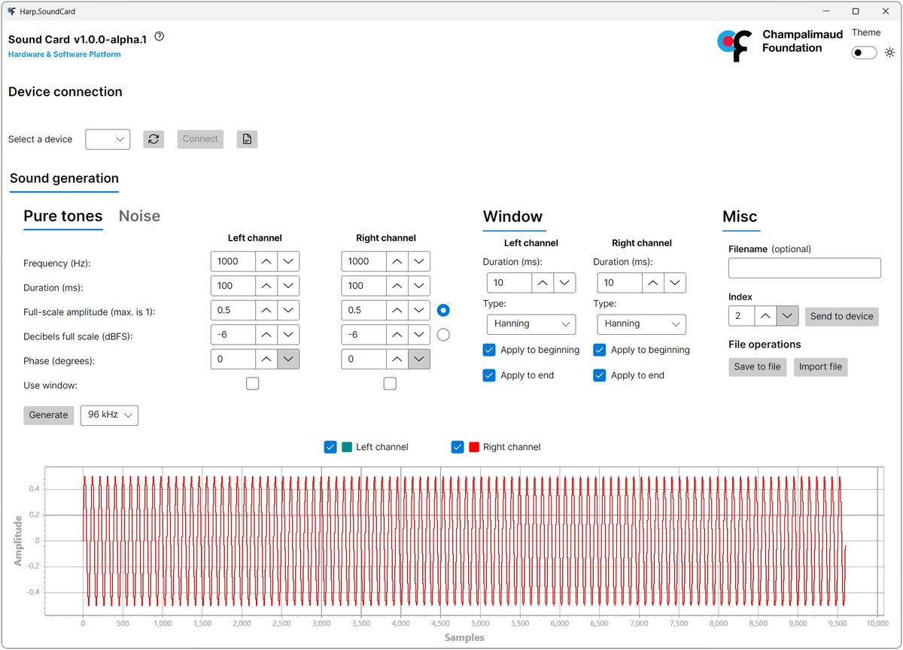
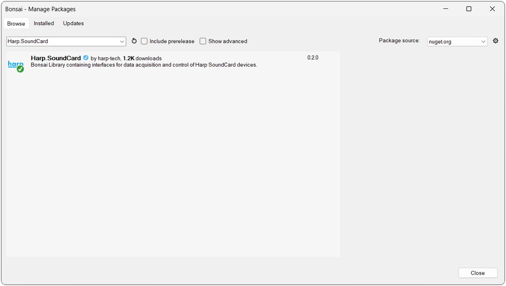

# Installation

This page covers the software you'll need to interact with the Sound Card, as well as how to update the firmware on the device.

## Software packages

These steps are only required the first time you connect the device to a new computer, and you can install just the packages for the functionality you need.

# [Driver](#tab/driver)

The WinUSB driver is required to upload waveforms to the onboard sound memory bank.

{width=575}

- Download and launch [Zadig](https://zadig.akeo.ie/).
- Connect the [USB (Soundbank)](ports-connections.md) cable to the computer.
- Select "Harp Sound Card" from the list. If the device is not available, go to "Options" > "List All Devices".
- Select the "WinUSB" driver and click "Install Driver".

# [Sound Card GUI](#tab/soundcardgui)

The Sound Card GUI offers a graphical interface for [generating and uploading waveforms](soundcard-gui.md).

{width=600}

- Download and install the [Sound Card GUI](https://github.com/fchampalimaud/device.soundcard/releases).

> [!NOTE]
> Alternatively, waveforms can be [generated and uploaded in Bonsai](../tutorials/upload-waveform-bonsai.md).

# [Bonsai](#tab/bonsai)

[Bonsai](https://bonsai-rx.org/) is a visual reactive programming language that provides flexible and comprehensive control of the Sound Card.

{width=600}

- Download and install [Bonsai](https://bonsai-rx.org/docs/articles/installation.html).
- Launch Bonsai and install the `Harp.SoundCard` package by searching for it in the [Bonsai package manager](https://bonsai-rx.org/docs/articles/packages.html).
- Install the `Bonsai.StarterPack` package to follow along with the examples in this user guide.

# [Python](#tab/python)

The [Harp](https://harp-tech.org/python/) library provides a Python interface for controlling Harp devices and [loading](logging-analysis.md) recorded data. To install the full library, install it in a Python environment with:

```cmd
pip install harp
```

To install only the package necessary for loading data:

```cmd
pip install harp-data
```

> [!NOTE]
> Substitute `uv add` for `pip install` if you are using the [uv](https://docs.astral.sh/uv/) package manager.

***

## Firmware update

New features are added and bugs are fixed with firmware updates which are published on the [release page](https://github.com/harp-tech/device.soundcard/releases) in the device GitHub repository. Each release contains `.hex` files tagged with the firmware (`fw`) and hardware (`hw`) version. For instance, `SoundCard-fw3.0-harp1.15-hw2.2-ass0.hex` is firmware v3.0 for a hardware v2.2 Sound Card. Download these two hex files from the "Assets" section under each release, making sure that the hardware prefix matches the [hardware version](soundcard.md#hardware) of the board:

- `SoundCard-*.hex` - Firmware for the 8-bit device interface microcontroller.
- `SoundCard.PIC32-*.hex` - Firmware for the 32-bit sound memory microcontroller.

> [!TIP]
> The hardware version is printed on the board silkscreen (e.g. `harp sound card v2.2`).

To update the firmware, use the [Harp Toolkit](https://harp-tech.org/toolkit/) command line tool:

1. Install the [.NET SDK](https://dotnet.microsoft.com/download) if the `dotnet` command is not already available on your computer.
2. Open a terminal and install the Harp Toolkit. The instructions below are for a system-wide installation:

    ```cmd
    dotnet tool install --global Harp.Toolkit
    ```

3. Navigate to the folder containing the two downloaded `.hex` files and run the update with the COM port of the device and the filename for the device interface microcontroller file. The sound memory microcontroller file is automatically loaded at the same time:

    ```cmd
    harp.toolkit update --port COM3 SoundCard-fw3.0-harp1.15-hw2.2-ass0.hex
    ```

After the update, the device will reboot with the new firmware. Refer to the [firmware update](https://harp-tech.org/toolkit/articles/update.html) guide of the Harp Toolkit if you run into any issues.

[!INCLUDE [](../includes/version-footer.md)]
