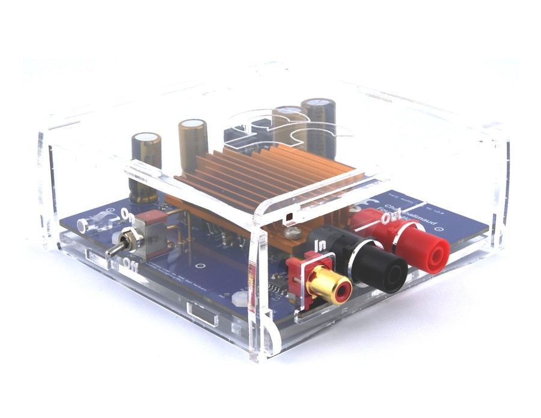

# Audio Amplifier

The Harp Sound Card Audio Amplifier is a peripheral for the Sound Card that amplifies one output channel with low distortion and a flat response across the full 80 kHz bandwidth, so the Sound Card can drive a speaker directly. Refer to the [connections](../ports-connections.md?tabs=audio#connections) article to set up the amplifier and the [Play sounds](../play-sound.md) article to play sounds through it in Bonsai.

{width=450}

## Key features

- Unity gain, so the Sound Card output level is reproduced at the speaker
- Flat frequency response from 20 Hz to 80 kHz for ultrasonic stimuli
- Dual 12 V supply inputs for a low-noise positive and negative rail

## Specs

- Number of channels: 1
- Input voltage: 2 × 12 V DC (positive and negative supply)
- Speaker output (with Sound Card): 0.5 W @ 8 Ω / 1 W @ 4 Ω
- Compatible speakers: 4 Ω impedance or higher; the XT25SC90-04 (Peerless by Tymphany) offers a good frequency response up to 80 kHz
- Connector: RCA input from the Sound Card, banana plug output to the speaker

## Benchmarks

- SNR: 119 dB (A-weighted, 80 kHz bandwidth)
- Spectral variation: <0.1 dB (20 Hz–80 kHz)
- Distortion: <0.03% @ 1 W

## Hardware

| Version | Compatible Sound Card | Notes |
| ------- | -------------------- | ----- |
| 2.x | All | <ul><li>Earliest version listed in the Sound Card compatibility table</li></ul> |

> [!WARNING]
> **TODO**: Fill in the hardware version history from the [peripheral.audioamp](https://github.com/harp-tech/peripheral.audioamp) repository's design files and releases.

Assembled units are available from the [Open Ephys store](https://open-ephys.org/harp), or build your own using the hardware design files in the [Audio Amplifier](https://github.com/harp-tech/peripheral.audioamp) repository.

[!INCLUDE ]
