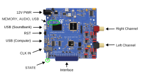
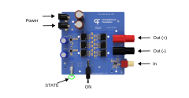
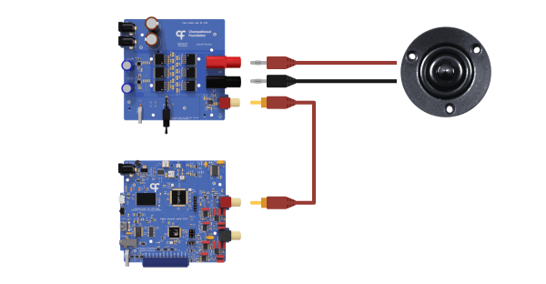
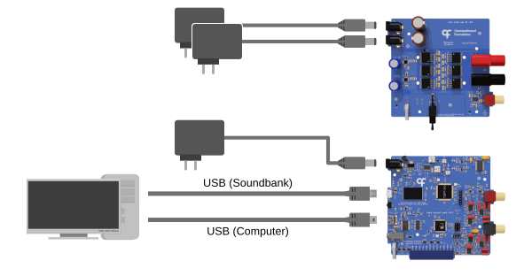
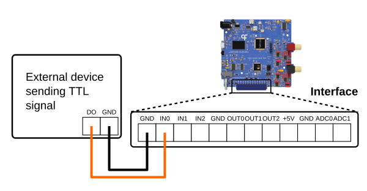
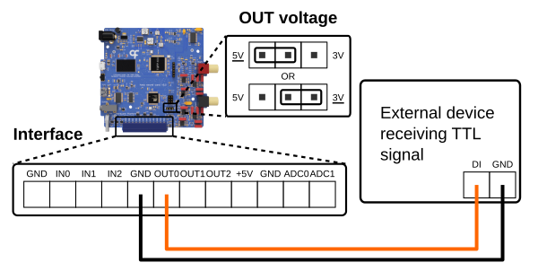
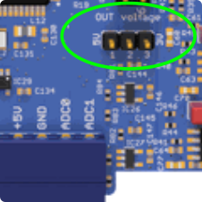
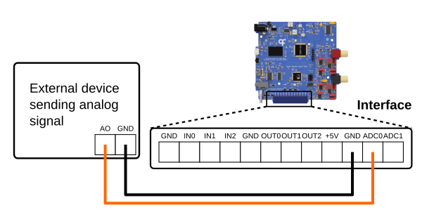
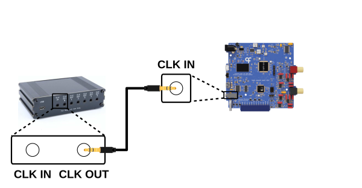

# Ports and connections

This article will cover the ports, controls, and status indicators on the Sound Card and the Audio Amplifier, as well as how to connect them to each other and to external devices.

## Sound Card

{width=600}

**12V PWR (Barrel Jack)** - This port powers the Sound Card and requires a 12 V power supply.

### Ports

**USB (Soundbank, Micro-B)** - This port connects to the device's onboard sound memory bank for uploading of waveforms. Once the sounds have been uploaded, the cable can be disconnected, as it is not required for sound playback.

**USB (Computer, Mini-B)** - This port connects to the device's internal controller to control sound playback with [Bonsai](bonsai.md) or the [GUI](soundcard-gui.md).

**CLK IN (Stereo Jack)** - This [Harp](https://harp-tech.org/articles/about.html) clock input port accepts a clock output from any compatible Harp clock generator or synchronizer (e.g. [Timestamp Generator Gen3](https://github.com/harp-tech/device.timestampgeneratorgen3)), which can be used to synchronize the internal clocks of connected devices.

**Interface (Screw Terminal)** - These general purpose input/output (GPIO) pins can be used to communicate with external devices, for example to trigger sound playback or control volume. Refer to the connection guide below for more information.

**Left Channel (RCA)** - This port can be used independently for mono output or together with the right channel for stereo output. Needs to be connected to an external amplifier and speakers.

**Right Channel (RCA)** - This port can be used independently for mono output or together with the left channel for stereo output. Needs to be connected to an external amplifier and speakers.

### Controls

**RST** - This button resets the sound controller in case of an error during sound upload or playback (not typically needed). The reset does not remove sounds stored in the soundbank or affect the connection between Bonsai and the device.

### Indicators

**STATE** - The LED cycles on and off with a period of:

- 2 seconds when it's communicating with Bonsai
- 4 seconds when in standby
- 100 milliseconds when a catastrophic error occurs

**MEMORY** - This LED turns on when the device is reading or writing to the soundbank. If it remains on, there is a problem accessing the soundbank.

**AUDIO** - This LED turns on while the device is producing audio.

**USB** - This LED turns on when sounds are being uploaded to the soundbank. It also remains on if the device does not detect a connection between the computer and soundbank.

## Audio Amplifier

{width=600}

**Power (Barrel Jack)** - These ports power the amplifier and require two separate 12 V power supplies, one for each power input.

**In (RCA)** - This port accepts an input from one of the Sound Card's [output channels](#ports).

**Out (Banana Plug, +/-)** - These terminals connect to the positive and negative terminals on a speaker.

**ON** - This switch turns the amplifier on and off.

**STATE** - This LED turns on if the amplifier is powered and the **ON** switch is enabled.

## Connections

# [Audio](#tab/audio)

{width=600}

1. Connect the **Left Channel** or **Right Channel** port on the Sound Card to the input port of an amplifier with an RCA cable. Any external amplifier that accepts line-level RCA inputs is supported. For high-fidelity applications, consider using the Harp [Audio Amplifier](./peripherals/audioamplifier.md), pictured above.
2. Connect the positive (+) speaker output of the amplifier, usually red, to the positive terminal of the speaker. Any speaker with an impedance from 4 to 8 Ω can be used with the Audio Amplifier; the XT25SC90-04 (Peerless by Tymphany) offers a good frequency response up to 80 kHz.
3. Connect the negative (−) speaker output of the amplifier, usually black, to the negative terminal of the speaker.
4. Repeat steps 1 to 3 with a second amplifier and speaker for the other channel for stereo output.

# [Power and PC](#tab/powerandpc)

{width=600}

1. Connect a 12 V power supply to the **12V PWR** port of the Sound Card.
2. If you are using the Audio Amplifier, connect two separate 12 V power supplies to the **Power** ports of the Audio Amplifier, one per input.
3. Connect the **USB (Computer)** port to the computer with a USB Mini-B cable.
4. If you are uploading waveforms to the Sound Card, connect the **USB (Soundbank)** port to the computer with a USB Micro-B cable. The cable is not required for playback of sounds.

> [!WARNING]
> Do not connect a single 12 V supply to both power inputs of the Audio Amplifier. This results in a short circuit.

# [Digital inputs](#tab/digitalinputs)

{width=600}

1. Connect a digital output from another device to **IN0**, **IN1**, or **IN2** on the **Interface** connector. The digital input lines run on 3.3 V logic levels but are 5 V tolerant.
2. Connect the ground of the other device to any **GND** pin, so that both share a common ground.
3. Refer to the [Configure digital inputs](configure-digitalinputs.md) article to trigger sounds from the inputs in Bonsai.

# [Digital outputs](#tab/digitaloutputs)

{width=600}

1. Connect **OUT0**, **OUT1**, or **OUT2** on the **Interface** connector to a digital input on the other device.
2. Connect the ground of the other device to any **GND** pin, so that both share a common ground.
3. Set the logic level of the outputs with the **OUT voltage** jumper located near the **Interface** connector. The default is 5 V and the alternative is 3.3 V; the setting applies to all three outputs.
4. Refer to the [Control digital outputs](control-digitaloutputs.md) article to drive the outputs in Bonsai.

{width=150}

# [Analog inputs](#tab/analoginputs)

{width=600}

1. Connect an analog output from another device to **ADC0** or **ADC1** on the **Interface** connector.
2. Connect the ground of the other device to any **GND** pin, so that both share a common ground.
3. Refer to the [Acquire analog data](acquire-analogdata.md) article to stream the analog inputs in Bonsai.

> [!WARNING]
> **TODO**: Verify the analog input voltage range on hardware. The repository README states 3.3 V maximum (5 V tolerant), while earlier documentation stated 0 to 5 V.

# [Harp synchronization](#tab/harpsynchronization)

{width=600}

1. Connect a clock output of a Harp clock generator (e.g. the [Harp Timestamp Generator](https://github.com/harp-tech/device.timestampgeneratorgen3)) to the **CLK IN** jack with a stereo jack cable.
2. The Sound Card adopts the generator's clock automatically. To verify the connection, check that the **STATE** LEDs of the connected boards blink simultaneously.
3. Refer to the [Harp synchronization clock](https://harp-tech.org/protocol/SynchronizationClock.html) documentation for how devices synchronize.

---

[!INCLUDE ]
