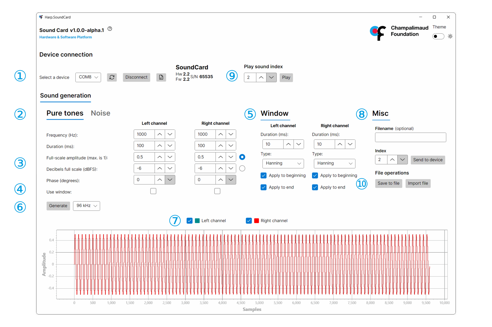

# Sound Card GUI

The Sound Card GUI provides an interface to generate and upload waveforms to the Sound Card.

> [!TIP]
> Alternatively, you can play [pure tones](play-sound.md) with the onboard sine wave generator or [upload waveforms in Bonsai](../tutorials/upload-waveform-bonsai.md), which offers greater flexibility and functionality.

Before beginning:
- [Install the GUI](installation.md#software-packages).
- Connect an amplifier and speaker to an output channel by following the [audio connection](ports-connections.md?tabs=audio#connections) instructions.
- Connect the power supply and both USB cables by following the [power and PC connection](ports-connections.md?tabs=powerandpc#connections) instructions. The GUI needs the **USB (Soundbank)** cable to upload sounds.
- Launch "Harp.SoundCard.App" from the Windows Start menu.

1. Select the port for the Sound Card, and press "Connect". The device details display on the right side once it is connected.
2. Select the tab for either pure tone or white noise generation.
3. Adjust the parameters for the sound. Amplitude can be set as a fraction of full scale (linear) or in dBFS (logarithmic); select the radio button for the option you want.
4. Select the channels to apply a window to. The window fades the sound in and out to prevent pops and clicks from abrupt transitions at sound onset and offset.
5. Adjust the window properties in this panel.
6. Choose the sampling rate and click "Generate". The sampling rate determines the range of reproducible frequencies.
7. Select the channels to upload.
8. Configure the sound index to upload and click "Send to device".
9. Select the sound index and press "Play" to hear the generated sound.
10. Save the waveform to a binary file, or load a previously saved binary file.

> [!TIP]
> dBFS is the standard unit for audio levels and maps more naturally to perceived loudness.

> [!WARNING]
> Only one program can access the device's COM port at a time. Close the GUI before starting a Bonsai workflow that uses the device. If you run into an error, check out the [troubleshooting](./errors.md) article.

[!INCLUDE ]
