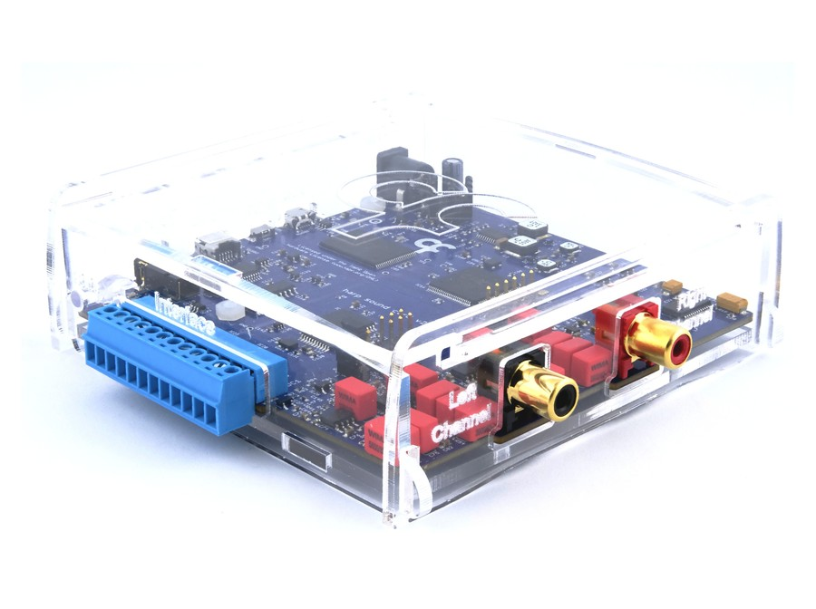

# Sound Card

{width=450}

## Key features

- Internal memory to store sounds, enabling low-latency sound delivery
- Pre-selected sounds can be triggered using an external TTL
- Internal wave generator allows the user to configure a pure tone without loading a sound file
- Stereo 24-bit output at up to 192 kHz sampling rate

## Specs

- Maximum sampling rate: 192 kHz
- Number of channels: 2
- Bit depth: 24 bits
- Input voltage: 12 V DC
- Output voltage: 2 V rms
- Flash memory: 30 indices, 8 MB per index (2 million samples)
- Sound duration: 10.922 s at 96 kHz sample rate, or 5.461 s at 192 kHz sample rate
- Timestamp resolution: 32 µs
- Synchronization frequency: 1 Hz
- Synchronization accuracy: 22 ± 16 µs (between clock generator and this device)
- Digital outputs: 3 (3.3 V or 5 V, default 5 V, adjustable by jumper setting)
- Digital inputs: 3 (5 V tolerant)
- Analog inputs: 2 (0–5 V, 12-bit analog-to-digital conversion)

## Benchmarks

- THD: -111 dB (1 kHz @ 2 V rms)
- Noise floor: 20 µV rms | -94 dB (20 Hz–80 kHz)
- SNR: 100 dB | 113 dBA (20 Hz–80 kHz @ 2 V rms)

## Hardware

| Version | Notes |
| ------- | ----- |
| 2.2 | <ul><li>Revised routing and silkscreen</li></ul> |
| 2.1 | <ul><li>Added analog inputs</li></ul> |
| 1.1 | <ul><li>Initial version</li></ul> |

## Firmware

| Version | Notes |
| ------- | ----- |
| 3.0 | <ul><li>Updated Harp core to 1.15</li><li>Reworked the register map</li></ul> |
| 2.2 | <ul><li>Updated Harp core to 1.13</li><li>Dropped Bpod serial communication support</li></ul> |
| 2.1 | <ul><li>Added the sine wave generator</li><li>Refactored the interface scripts to take the libusb dependency from NuGet</li><li>Added the prototype device schema and interface</li><li>Updated the interface to use the new generators</li></ul> |
| 2.0 | <ul><li>Initial version</li></ul> |

[!INCLUDE ]
