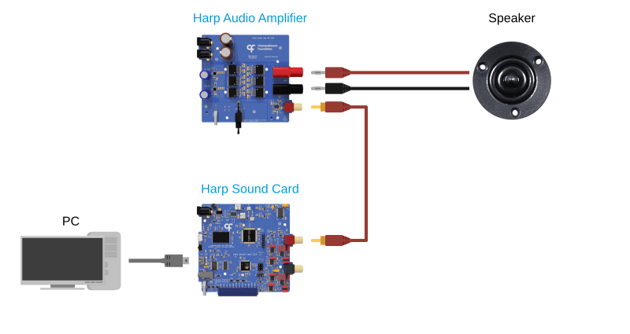

# Overview

The Harp [Sound Card](articles/soundcard.md) and [Audio Amplifier](articles/peripherals/audioamplifier.md) are open-source, high-fidelity audio devices specifically designed for behavioral research experiments.

Consumer-grade audio systems are designed to operate within the human auditory domain, are not optimized for real-time audio applications, and rarely support synchronization or precise triggering of auditory stimuli.

The Sound Card provides:

- Wideband frequency support up to 80 kHz for experiments involving ultrasonic communication.
- Low-latency sound playback via onboard waveform storage and digital input triggering for close-loop experiments.
- Convenient generation of auditory stimuli, with a [GUI](articles/soundcard-gui.md) to create and upload waveforms and an onboard sine wave generator for pure tones.
- Hardware timestamping and synchronization with other [Harp](https://harp-tech.org/articles/about.html) devices for seamless alignment of experimental data.
- [Bonsai](https://bonsai-rx.org/) integration for flexible experiment acquisition and control.

The Sound Card requires an amplifier to drive speakers for sound playback, and the Audio Amplifier has been designed to pair with it for low-distortion amplification. A full end-to-end audio characterization of these two devices with a connected speaker has been documented in this [publication](https://doi.org/10.1016/j.ohx.2024.e00555).

## Getting a device

Assembled units are available from the [Open Ephys store](https://open-ephys.org/harp), or build your own using the hardware design files in the [Sound Card](https://github.com/harp-tech/device.soundcard) or [Audio Amplifier](https://github.com/harp-tech/peripheral.audioamp) repository. Once you have a device, follow the "Getting started" section to [set up the device](./articles/ports-connections.md) and install the [software](./articles/installation.md).

## Acknowledgments

Hardware design and GUI contributed by [Champalimaud Foundation](https://www.cf-hw.org/), Bonsai interface by [NeuroGEARS](https://neurogears.org/), testing and feedback by [Allen Institute for Neural Dynamics](https://www.allenneuraldynamics.org/), and documentation by [Open Ephys](https://open-ephys.org/).

[!INCLUDE ]
